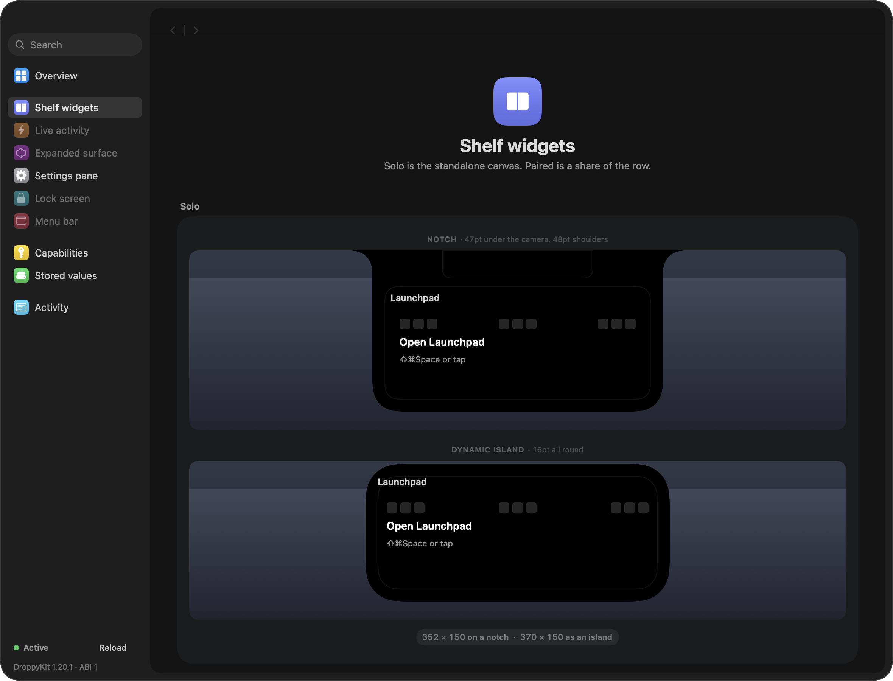

# Launchpad for Droppy

**The old MacBook Launchpad — back, and living in your notch.**

Apple removed the classic Launchpad in macOS 26. Launchpad for Droppy brings it back: tap the tile on Droppy's shelf, and a fullscreen launchpad opens over whatever you were doing — every app on your Mac, on swipeable pages of big icons, with instant search. Escape, and you're back where you were.

It is not a separate app. It is a **Droplet** — a small extension that runs inside [Droppy](https://getdroppy.app), the notch for Mac — so the launcher is always one tap away, on any screen, in any app, with zero background processes of its own.

  

## Features

- **Fullscreen dark glass** — the classic Launchpad look: the desktop blurs behind a single dark sheet while it's up, and nothing behind it can be touched
- **Every app on your Mac** — a recursive scan of the standard folders plus live Spotlight discovery finds application bundles wherever they live, deduplicated by bundle identifier
- **Pages, not scrolling** — a fixed grid of big icons with page dots underneath, flipped by two-finger swipe, drag, or the arrow keys
- **Instant search** — type to filter the grid; Return launches the first match
- **⇧⌘Space** — a global keyboard shortcut that opens or closes it from anywhere
- **Hot corner** — flick the cursor into a chosen corner to open or close it, on any screen, in any app
- **Folders, renaming, hiding** — drag apps together, rename, hide, rearrange; your arrangement persists
- **Settings** — launcher mode (fullscreen / floaty panel), icon size (small / medium / large), page direction (horizontal / vertical), gap collapsing, arrangement reset — all in Droppy's Settings ▸ Launchpad
- **Micro-animations** — the tile ripples on hover, pages settle smoothly, the glass fades in

## Requirements

- **Droppy** 15.3.0 or later on macOS 14+ (built with DroppyKit, ABI 1)
- Apple Silicon or Intel

## Install

1. Download **Launchpad.droplet.zip** from this repository and unzip it.
2. In Droppy: **Settings ▸ Store ▸ Local droplets**, choose the unzipped `Launchpad.droplet`, and approve it when asked.
3. Tap the **Launchpad** tile on the shelf. That's it — no background app, nothing to keep running.

## Controls

| Action | Trigger |
| --- | --- |
| Open / close | ⇧⌘Space, the shelf tile, or flick the cursor into your hot corner |
| Change page | Two-finger swipe (any direction), drag, ← / → |
| Search | Type while it's open |
| Launch first match | Return |
| Open an app | Click its icon |
| Close | Escape or click the desktop |

## How it's built

Launchpad is a [DroppyKit](https://getdroppy.app/docs/droppykit) droplet: a dynamic-library bundle Droppy loads into its own process. The launcher engine — grid, paging, search, icon pipeline, folders, window management — was ported wholesale from [Launchy](https://github.com/Punshnut/macos-launchy) by Punshnut, an excellent open-source Launchpad alternative; the Droppy shell (shelf widget, settings pane, integration) is a thin adapter around that engine. App discovery combines a recursive folder scan (including the Cryptexes and CoreServices, where macOS 26+ stows system apps) with live Spotlight discovery, deduplicated by bundle identifier.

## Credits

- **Launchy** by Punshnut — the launcher engine this droplet ports, under the GPL-compatible AGPL-3.0
- **Droppy** by Jordy Spruit — the platform, and the DroppyKit SDK that makes droplets possible

## License

AGPL-3.0. The engine is Launchy's code, ported under that licence (`LICENSE-Launchy`); this droplet is distributed under the same licence (`LICENSE`) — the source in this repository is the complete, buildable project (`droppykit build` produces `Launchpad.droplet`).
